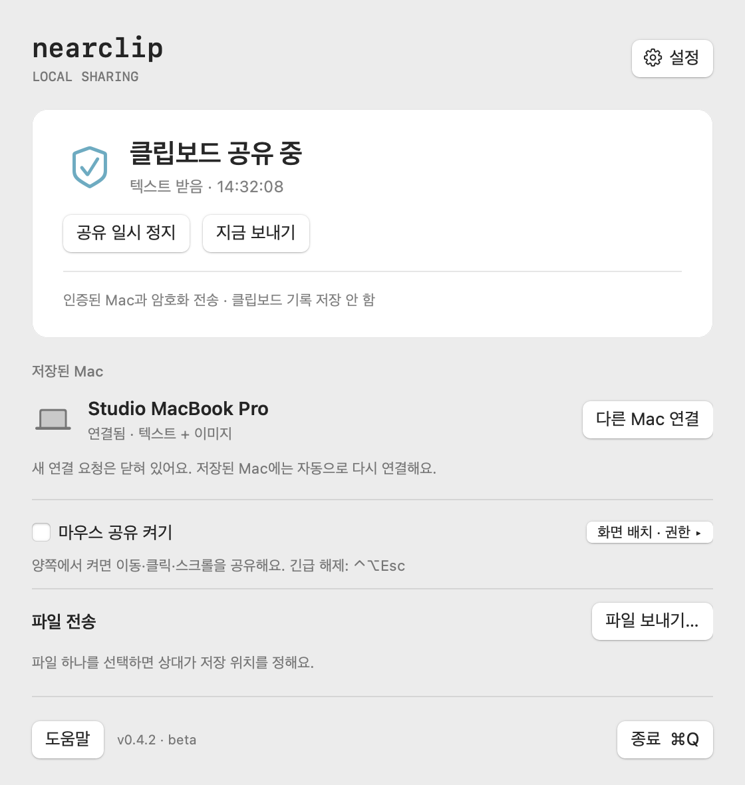

# NearClip

**Share a clipboard, mouse, and files between two Macs.**

NearClip is a native macOS menu bar app for two Macs on the same local network. Different Apple accounts are supported. No account, cloud service, or third-party runtime is required.

[**Download for macOS**](https://github.com/iyk2h/nearclip/releases/tag/v0.4.2) · [Troubleshooting](docs/TROUBLESHOOTING.md) · [Development](docs/DEVELOPMENT.md) · [Roadmap](docs/ROADMAP.md)

> **Experimental public beta.** Version 0.4.2 is not notarized by Apple. Mouse and file sharing have automated coverage, but have not yet been validated on two physical Macs. The interface is Korean; this guide includes the button labels.

## Install

Use macOS 13 or later. Apple Silicon and Intel are supported. On both Macs:

1. Quit the previous NearClip, if it is running.
2. Download `NearClip-0.4.2-macOS.dmg` from the [release page](https://github.com/iyk2h/nearclip/releases/tag/v0.4.2).
3. Open the DMG and drag **NearClip** to **Applications**.
4. Open NearClip and allow local network access when macOS asks.

If macOS blocks the first launch, use the [first-launch instructions](docs/TROUBLESHOOTING.md#macos-blocks-the-first-launch).

## Connect

1. Connect both Macs to the same Wi-Fi or wired network and open NearClip.
2. Click **Connect (`연결`)** beside the other Mac's name.
3. Compare the six digits. If they match, click **Confirm (`숫자가 같아요 · 연결`)** on both Macs.

The saved Macs reconnect automatically. To replace a pairing, click **Connect another Mac (`다른 Mac 연결`)** on each previously paired Mac. New pairing opens for two minutes and still requires both confirmations.

If no Mac appears, expand **Mac not visible? (`Mac이 보이지 않나요?`)**. Use the other Mac's displayed address through **Connect by address (`주소로 연결…`)**.

## Clipboard

Copy new text or an image, then press `⌘V` on the other Mac. NearClip shares plain text and image clipboard content up to 20 MiB and 40 million pixels. It does not keep clipboard history.

Copies made before connection or while paused are not sent automatically. Use **Send now (`지금 보내기`)** to send the current clipboard. For a screenshot directly on the clipboard, press `⌃⇧⌘4`.

## Mouse and screen layout

Use 0.4.2 or later for the graphical arrangement controls. Mouse sharing works with a paired Mac running 0.4 or later.

1. On the main screen, expand **Screen arrangement and permissions (`화면 배치 · 권한`)** below the connected Mac.
2. Drag either monitor card to match the Macs' physical left-to-right order. Release it to apply the same order on both Macs. You can also use **Swap order (`순서 바꾸기`)**.
3. Enable **Mouse sharing (`마우스 공유 켜기`)** on both Macs. This expands setup automatically. You can collapse setup while sharing stays on.
4. Allow the missing permissions shown in the app. The app checks again when you return from System Settings. Then enable sharing again. Restart only if macOS requires it or the permission still has not taken effect.
5. Push the cursor against the configured outer edge to cross to the other Mac. Return through the edge where it entered.

**Press `⌃⌥Esc` to disable mouse sharing and reclaim control.** Local mouse input on the receiving Mac also reclaims control. A lost connection releases held buttons and returns control. Re-enable sharing after a disconnect, pause, or app restart.

Movement, left/right/middle clicks, dragging within the receiving Mac, and scrolling are supported. Keyboard input stays on the local Mac and ends remote mouse control. This version does not drag files across the screen boundary. Each card represents one Mac, including its attached displays. This version sets horizontal Mac order; individual monitor placement and vertical arrangements are not included. Press Escape while dragging to cancel. End remote mouse control before changing the arrangement.

NearClip does not change Apple Universal Control settings. If another Apple device also takes the pointer, use the **Apple mouse sharing help (`Apple 마우스 공유와 겹치나요?`)** button in the expanded setup.

## Apple clipboard relay

**Settings (`설정`) → Prevent Apple relay of received clipboard (`받은 클립보드의 Apple 기기 재공유 막기`)** is on by default. NearClip marks new received clipboard items for this Mac only, using Apple's [`currentHostOnly`](https://developer.apple.com/documentation/appkit/nspasteboard/contentsoptions/currenthostonly) option.

This does not block copies made in other apps, content already shared, or a manual re-copy. It does not turn off iCloud or Handoff. For a system-wide change, use the Apple clipboard settings guide inside the app. Turning off Handoff also affects other Continuity features. See [troubleshooting](docs/TROUBLESHOOTING.md#apple-clipboard-or-mouse-sharing-overlaps).

## Files

1. Click **Send file (`파일 보내기…`)** below the mouse controls and select one file.
2. On the other Mac, choose a destination and click **Receive (`받기`)**.
3. Wait for completion. Use **Show in Finder (`Finder에서 보기`)** to locate the received file.

One regular file up to 2 GiB can be transferred at a time. Compress folders into ZIP files first. Source files stay on the sending Mac. Finder's Copy command does not automatically send files.

Transfers are encrypted and checked with SHA-256. Existing destination files are never overwritten. Received files are private, non-executable, and marked for macOS first-open security checks. A filesystem that supports hard links and extended attributes is required for receiving; use a local Mac folder if saving to an external volume fails.

## Menu bar and lifecycle

| Action | Control |
| --- | --- |
| Pause sharing and cancel active file/input work | `공유 일시 정지` |
| Resume clipboard sharing | `공유 다시 시작` |
| Open file and mouse controls | `파일·마우스 공유…` |
| Stop mouse sharing only | `마우스 공유 끄기` or `⌃⌥Esc` |
| Quit | `종료` or `⌘Q` while NearClip is active |
| Choose close behavior | Settings (`설정`) → `창을 닫으면` |
| Start at login | Settings → `로그인할 때 NearClip 시작` |
| Forget the paired Mac | Settings → `연결 해제…` |

The first window close asks whether to quit or keep running in the menu bar. Quitting stops all sharing. Choosing to keep running allows sharing to continue.

## Security, validation, and development

Clipboard pairing alone does not enable mouse control or accept files. See [Security](SECURITY.md) and [Validation](docs/VALIDATION.md) for the trust model, completed checks, and limits.

Windows support is planned, not included. The [sharing protocol](docs/SHARING-PROTOCOL.md) separates portable messages from platform adapters. [Design references](docs/DESIGN-REFERENCES.md) explain the UI direction.

Report problems in [Issues](https://github.com/iyk2h/nearclip/issues). Include OS/app versions and reproduction steps. Do not include private clipboard content, files, or pairing secrets.

[MIT License](LICENSE)
