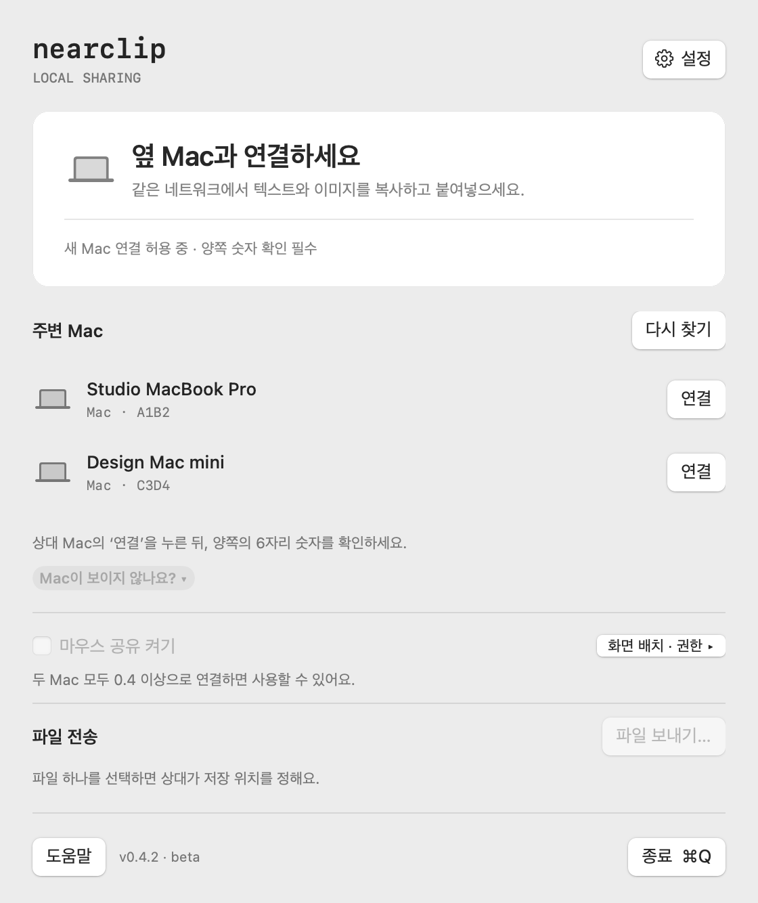

# NearClip

**Copy on one Mac. Paste on the other.**

NearClip is a native macOS menu bar app. It shares text and images between two Macs on the same local network. The Macs can use different Apple accounts. No account, cloud service, or third-party runtime is required.

[**Download for macOS**](https://github.com/iyk2h/nearclip/releases/tag/v0.3.0) · [Troubleshooting](docs/TROUBLESHOOTING.md) · [Development](docs/DEVELOPMENT.md) · [Roadmap](docs/ROADMAP.md)

> **Public beta.** Version 0.3.0 is not notarized by Apple. The app interface is currently in Korean. The steps below include the button labels shown in the app.

## Install

Use macOS 13 or later. Apple Silicon and Intel are supported. Complete these steps on both Macs.

1. Download `NearClip-0.3.0-macOS.dmg` from the [release page](https://github.com/iyk2h/nearclip/releases/tag/v0.3.0).
2. Open the DMG file.
3. Drag **NearClip** to **Applications**.
4. Open **NearClip** from Applications.
5. Allow local network access when macOS asks.

If macOS blocks the first launch, follow the [first-launch instructions](docs/TROUBLESHOOTING.md#macos-blocks-the-first-launch).

## Connect the Macs

1. Connect both Macs to the same Wi-Fi or wired network.
2. Open NearClip on both Macs.
3. On one Mac, open **Connection (`연결`)**.
4. Select the other Mac from the list.
5. Click **Connect (`연결`)**.
6. Compare the six digits on both screens.
7. If they match, click **Confirm (`숫자가 같아요 · 연결`)** on both Macs.
8. Wait for **CONNECTED**.
9. Copy new text or an image, then press `⌘V` on the other Mac.

If the list is empty, find the address under **Direct connection (`직접 연결`)** on the other Mac. Enter it through **Connect by address (`주소로 연결…`)**. Then compare the digits as described above.

## Use the menu bar

Click the clipboard icon in the macOS menu bar to open NearClip or control sharing.

| Action | Control |
| --- | --- |
| Pause sending and receiving | `공유 일시 정지` |
| Resume sharing | `공유 다시 시작` |
| Send the current clipboard | `지금 보내기` |
| Quit the app | `NearClip 종료` or `⌘Q` while NearClip is active |
| Choose what happens when the window closes | Settings (`설정`) → `창을 닫으면` |
| Start at login | Settings → `로그인할 때 NearClip 시작` |
| Forget the paired Mac | Settings → `연결 해제…` |

The first time you close the window, NearClip asks whether to quit or stay in the menu bar. Select `이 선택 기억하기` to save your choice. Quitting stops sharing. Closing the window can keep sharing active if you choose that option.

## What it shares

- Plain text and image clipboard content.
- Images up to 20 MiB and 40 million pixels.
- New copies made after connection or resume. Earlier copies are not sent automatically.

To copy a screenshot directly to the clipboard, press `⌃⇧⌘4`.

NearClip does **not** transfer Finder files, share a mouse or keyboard, or keep clipboard history. Pairing a new Mac replaces the previous pairing. Version 0.3.0 targets two-Mac use.

Clipboard content is encrypted in transit. See [Security](SECURITY.md) for the trust model and limits, and [Validation](docs/VALIDATION.md) for completed tests.

## Report a problem

Open an [issue](https://github.com/iyk2h/nearclip/issues). Include your macOS version, NearClip version, and steps to reproduce the problem. Do not include private clipboard content or pairing secrets.

[MIT License](LICENSE)
