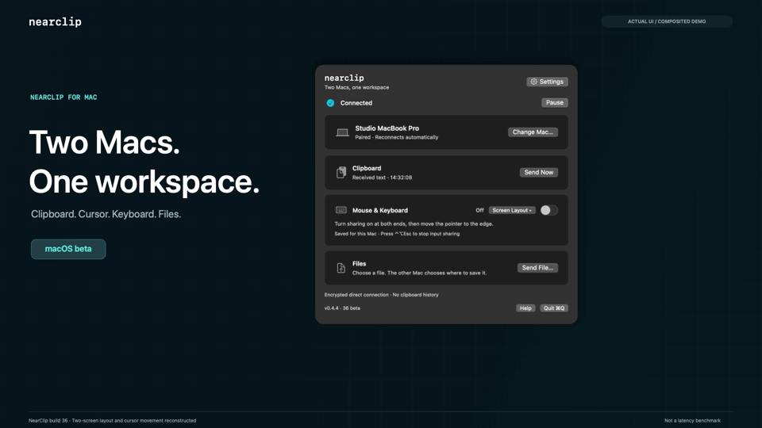

# NearClip

**Share a clipboard, mouse, keyboard, and files between two Macs.**

NearClip is a native macOS menu bar app for two Macs on the same local network. Different Apple accounts are supported. No account, cloud service, or third-party runtime is required.

[**Download for macOS**](https://github.com/iyk2h/nearclip/releases/tag/v0.4.4-build33) · [Troubleshooting](docs/TROUBLESHOOTING.md) · [Development](docs/DEVELOPMENT.md) · [Roadmap](docs/ROADMAP.md)

> **Experimental public beta.** Version 0.4.4 build 33 is not notarized by Apple. Input sharing remains experimental; the full two-Mac sleep/network test matrix is pending. The interface is Korean; this guide includes the button labels.

[Watch or download the 40-second film with sound](docs/media/nearclip-connected.mp4?raw=true) · [Main screen](docs/connected.png) · [How this demo was made](docs/media/README.md)

*Real app captures, edited into a two-Mac demonstration. Captured from development build 35; the public download above is build 33. This is not a simultaneous two-Mac recording or a speed test.*

## Install

Use macOS 13 or later. Apple Silicon and Intel are supported. On both Macs:

1. Quit the previous NearClip, if it is running.
2. Download `NearClip-0.4.4-build33-macOS.dmg` from the [release page](https://github.com/iyk2h/nearclip/releases/tag/v0.4.4-build33).
3. Open the DMG and drag **NearClip** to **Applications**.
4. Open NearClip and allow local network access when macOS asks.

If macOS blocks the first launch, use the [first-launch instructions](docs/TROUBLESHOOTING.md#macos-blocks-the-first-launch).

## Connect

1. Connect both Macs to the same Wi-Fi or wired network and open NearClip.
2. Click **Connect (`연결`)** beside the other Mac's name.
3. Compare the six digits. If they match, click **Confirm (`숫자가 같아요 · 연결`)** on both Macs.

Saved Macs reconnect automatically after wake or a network change. A stale saved address does not block a newly discovered route. **Find again (`연결 다시 찾기`)** preserves working connections and file transfers. To replace a pairing, click **Change Mac (`Mac 변경…`)** on each paired Mac. New pairing opens for two minutes and requires both confirmations.

If no Mac appears, expand **Mac not visible? (`Mac이 보이지 않나요?`)**. Use the other Mac's displayed address through **Connect by address (`주소로 연결…`)**.

## Clipboard

Copy new text or an image, then press `⌘V` on the other Mac. NearClip shares plain text and image clipboard content up to 20 MiB and 40 million pixels. It does not keep clipboard history.

Copies made before connection or while paused are not sent automatically. Use **Send now (`지금 보내기`)** to send the current clipboard. For a screenshot directly on the clipboard, press `⌃⇧⌘4`.

## Mouse, keyboard, and screen layout

Install the current version on both Macs. The main window groups clipboard, input, and file controls. Settings contains version details and diagnostics.

1. On the main screen, expand **Screen arrangement (`화면 배치`)** below the connected Mac.
2. Drag either monitor card to match the Macs' physical left-to-right order. Release it to apply the same order on both Macs. You can also use **Swap order (`순서 바꾸기`)**.
3. Turn on the **Mouse and keyboard (`마우스·키보드`)** switch on both Macs. Screen arrangement can stay collapsed while sharing is on.
4. Allow the missing permissions shown in the app. The app checks again when you return from System Settings. Then enable sharing again. Restart only if macOS requires it or the permission still has not taken effect.
5. Push the cursor against the configured outer edge. A vertical bar fills as the handoff starts. After acceptance, it becomes a thin bar and the keyboard follows the pointer. Return through the edge where it entered.

**Press `⌃⌥Esc` to disable input sharing and reclaim control.** Physical input on the receiving Mac also returns control.

Build 22 remembers your input-sharing choice for the paired Mac across sleep, disconnection, app restart, and later updates. Readiness resumes after the same Mac authenticates and native permissions pass. Each handoff still needs the other Mac's input-sharing approval. Pause, explicit stop, emergency stop, permission loss, and pairing replacement clear the choice. Enable the switch once after upgrading from an older build.

Input uses a separate encrypted connection from clipboard and file traffic. Both Macs need build 17 or later to recover input without interrupting a file transfer.

Movement, left/right/middle clicks, dragging within the receiving Mac, and scrolling are supported. Keyboard letters, shortcuts, modifiers, and repeat events use the receiving Mac’s input source. Select the desired input language there. Media keys and Touch ID are not shared. Build 31 includes [experimental three- and four-finger swipes](docs/GESTURES.md). Physical gesture behavior is not yet validated. NearClip preserves two-finger scroll and momentum phases. It does not change your trackpad settings. Secure Event Input pauses control. The app identifies the blocked Mac. Finish protected input on that Mac directly. When the pause clears, move to the edge again. With an older mouse-only peer, typing stays local and ends control. This version does not drag files across the screen boundary. Each card represents one Mac, including its attached displays. This version sets horizontal Mac order; individual monitor placement and vertical arrangements are not included. Press Escape while dragging to cancel. End remote mouse control before changing the arrangement.

NearClip does not change Apple Universal Control settings. If another Apple device also takes the pointer, use the **Apple mouse sharing guide (`Apple 마우스 공유 안내`)** button in Settings → Connection diagnostics.

## Apple clipboard relay

**Settings (`설정`) → Prevent Apple relay of received clipboard (`받은 클립보드의 Apple 기기 재공유 막기`)** is on by default. NearClip marks new received clipboard items for this Mac only, using Apple's [`currentHostOnly`](https://developer.apple.com/documentation/appkit/nspasteboard/contentsoptions/currenthostonly) option.

This does not block copies made in other apps, content already shared, or a manual re-copy. It does not turn off iCloud or Handoff. For a system-wide change, use the Apple clipboard settings guide inside the app. Turning off Handoff also affects other Continuity features. See [troubleshooting](docs/TROUBLESHOOTING.md#apple-clipboard-or-mouse-sharing-overlaps).

## Files

1. Click **Send file (`파일 보내기…`)** below the mouse controls and select one file.
2. On the other Mac, choose a destination and click **Receive (`받기`)**.
3. Wait for completion. Use **Show in Finder (`Finder에서 보기`)** to locate the received file.

One regular file up to 2 GiB can be transferred at a time. Compress folders into ZIP files first. Source files stay on the sending Mac. Finder's Copy command does not automatically send files.

Transfers are encrypted and checked with SHA-256. Existing destination files are never overwritten. Received files are private, non-executable, and marked for macOS first-open security checks. A filesystem that supports hard links and extended attributes is required for receiving; use a local Mac folder if saving to an external volume fails.

## Menu bar and lifecycle

| Action | Control |
| --- | --- |
| Pause sharing and cancel active file/input work | `공유 일시 정지` |
| Resume clipboard sharing | `공유 다시 시작` |
| Turn mouse and keyboard sharing on or off | `마우스·키보드 공유` (checked when requested) |
| Swap the two screen positions | `화면 좌우 바꾸기` (available when remote control is idle) |
| Open file and screen controls | `파일·화면 배치…` |
| Stop mouse sharing only | `마우스·키보드 공유 끄기` or `⌃⌥Esc` |
| Quit | `종료` or `⌘Q` while NearClip is active |
| Choose close behavior | Settings (`설정`) → `창을 닫으면` |
| Start at login | Settings → `로그인할 때 NearClip 시작` |
| Forget the paired Mac | Settings → `연결 해제…` |

The first window close asks whether to quit or keep running in the menu bar. Quitting stops all sharing. Choosing to keep running allows sharing to continue.

## Updates and connection diagnostics

For a repeatable speed and smoothness comparison, see [Measuring input responsiveness](docs/INPUT-PERFORMANCE.md).

From build 21, you can update directly in NearClip. You do not need to transfer a ZIP between Macs.

1. Finish or cancel file transfers.
2. Choose **Check for updates (`업데이트 확인…`)** in the menu bar or Settings.
3. Choose **Install Update**.
4. Choose **Install and Relaunch**.
5. Do these steps on the other Mac.

NearClip validates the signed update and opens the new app. Pairing and settings stay in place. From build 22, the input-sharing choice also stays in place for the same pairing.

For build 20 or earlier, quit NearClip and replace it with the current download once. Later updates can use the app's update window. Run the installed app from a writable folder, such as Applications, rather than from a mounted DMG.

The app checks public GitHub releases once a day, including beta releases. Turn off **Check automatically (`새 버전 자동 확인`)** for manual checks only. Automatic checks do not install an update or interrupt sharing. **Public releases (`공개 배포 보기`)** remains available for manual downloads.

**Connection diagnostics (`연결 진단`)** shows input-channel round-trip time, p95, variation between samples, and maximum recent input queue wait. Both Macs need build 17. These measurements exclude display rendering and are not full pointer-to-screen latency. The connection status at the top stays unchanged during normal handoffs.

## Security, validation, and development

Clipboard pairing alone does not enable mouse control or accept files. See [Security](SECURITY.md) and [Validation](docs/VALIDATION.md) for the trust model, completed checks, and limits.

Windows support is planned, not included. The [sharing protocol](docs/SHARING-PROTOCOL.md) separates portable messages from platform adapters. [Design references](docs/DESIGN-REFERENCES.md) explain the UI direction.

Report problems in [Issues](https://github.com/iyk2h/nearclip/issues). Include OS/app versions and reproduction steps. Do not include private clipboard content, files, or pairing secrets.

[MIT License](LICENSE)
